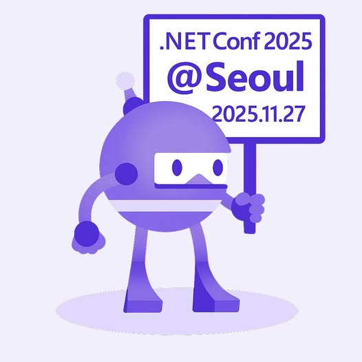

Title: .NET Conf 2026 @Seoul
---

    

  작년 행사가 궁금하신가요? <a href="/conf/2025/" class="alert-link">.NET Conf 2025 @Seoul 보기</a>

## 👋 소개

전 세계 개발자 컨퍼런스 .NET Conf와 함께하는 한국 로컬 행사입니다.
최신 .NET 기술 소식과 적용 사례를 공유하고,
국내 개발자들의 경험과 인사이트를 나누는 자리입니다.
기술 발표와 네트워킹을 통해 새로운 가능성을 탐색하고,
함께 성장하는 시간을 만나보세요. 🚀

**.NET Conf 2026 @Seoul**을 준비하고 있습니다. 일정과 프로그램은 추후 공개됩니다.

---

## 📅 행사일정

 

- **일정:** 2026년 하반기 예정 (일자 미정)
- **장소:** 미정

---

## 🤝 후원사

 

**.NET Conf 2026 @Seoul**을 함께 만들어갈 후원사를 모집할 예정입니다.

  <a href="https://forms.office.com/r/3cMZLnaq1X" target="_blank" class="btn btn-primary btn-lg px-5 py-3 fw-bold">
    후원사 신청하기
  </a>

---

## 🕒 시간표

 

시간표는 준비 중입니다. 공개되면 이 페이지에서 안내합니다.

---

## 🎤 발표자

 

발표자 라인업은 준비 중입니다. 발표 제안 관련 문의는 운영진에게 연락해 주세요.

---

## 🙌 운영진

**.NET Conf 2026 @Seoul**도 커뮤니티 중심으로 운영됩니다.
